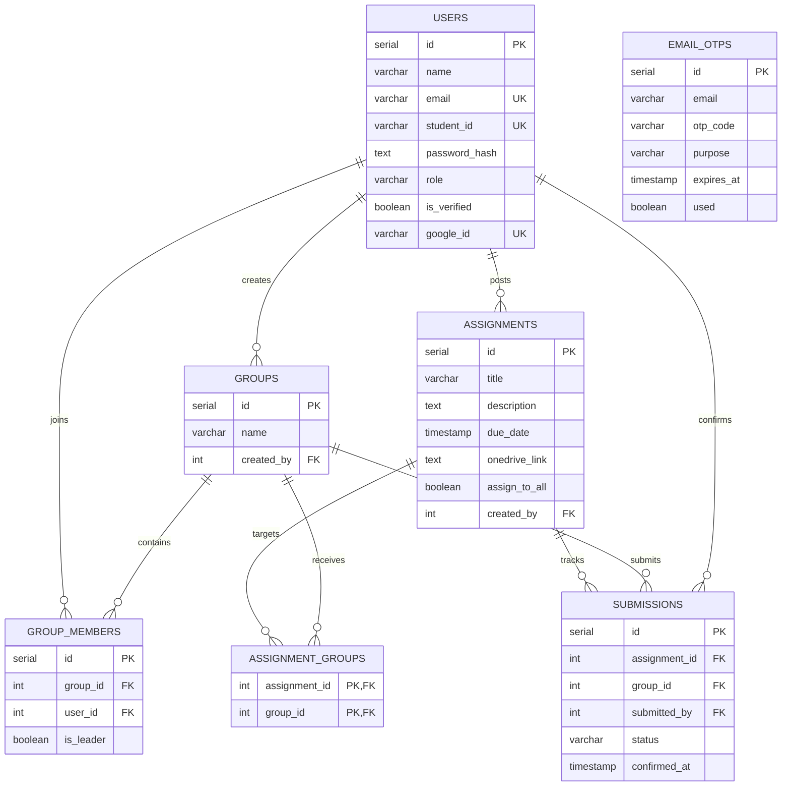

# Joineazy — Student, Group & Assignment Management System

A full-stack, role-based web platform enabling students to form groups, manage teammates, access OneDrive submission links, and verify submissions through a two-step confirmation flow—while professors create targeted assignments and track real-time completion analytics.

---

## Key Features

### Authentication & Security
- **Role-Based JWT Access Control** (`STUDENT` and `ADMIN` / Professor roles).
- **Gmail OTP Verification** for new account registration (10-minute expiring 6-digit codes stored in PostgreSQL).
- **Forgot & Reset Password via Gmail OTP**.
- **Google OAuth 2.0 Sign-In** with automatic account linking and JWT issuance.

### Student Role
- Create groups and automatically become the group leader.
- Add or remove group members using **Student Email or Student ID** (e.g., `STU101`).
- View all general and group-targeted assignments with OneDrive links and due dates.
- Confirm submissions via a **two-step verification workflow** (*"Yes, I have submitted"* → group selection & checkbox confirmation modal).
- Track completion visually using an animated progress bar and status badges.

### Professor (Admin) Role
- Create, edit, and delete assignments with OneDrive submission links and deadlines.
- Target assignments to **All Students** or **Specific Groups**.
- Monitor **group-wise** and **student-wise** submission confirmations in dedicated tables.
- View real-time **Recharts analytics** (confirmed vs. pending submissions per assignment and group completion rates).

---

## System Architecture Overview

```text
[ React + Vite + Tailwind/SCSS ]
        │  HTTPS / JSON + Bearer JWT
        ▼
[ Node.js + Express REST API ]  ──►  Gmail SMTP (Nodemailer OTP)
        │                       ──►  Google OAuth 2.0 Token Verification
        │  Parameterized SQL (pg Pool)
        ▼
[ PostgreSQL (Neon Cloud / Docker) ]
```

1. **Frontend (`frontend/`)**: Single-page React app communicating via a centralized Axios client that injects JWT tokens from `localStorage`.
2. **Backend (`backend/`)**: Modular Express API organized into `config/`, `middleware/`, `controllers/`, and `routes/`. Protected routes verify JWT signatures (`authenticate`) and enforce role gates (`authorize('ADMIN')` / `authorize('STUDENT')`).
3. **Database**: Normalized PostgreSQL relational schema initialized automatically via `src/config/initDb.js`, with transactional writes (`BEGIN` / `COMMIT` / `ROLLBACK`) for multi-table operations like group creation and targeted assignment publishing.

---

## Database Schema & ER Diagram



---

## API Endpoints

### Auth (`/api/auth`)
| Method | Endpoint | Access | Description |
| :--- | :--- | :--- | :--- |
| `POST` | `/api/auth/send-register-otp` | Public | Sends a 6-digit verification OTP to Gmail |
| `POST` | `/api/auth/register` | Public | Verifies OTP and creates a Student/Admin account |
| `POST` | `/api/auth/login` | Public | Authenticates user and returns JWT |
| `POST` | `/api/auth/google` | Public | Verifies Google ID token and issues JWT |
| `POST` | `/api/auth/forgot-password` | Public | Sends password reset OTP to Gmail |
| `POST` | `/api/auth/reset-password` | Public | Verifies reset OTP and updates password |
| `GET` | `/api/auth/me` | Authenticated | Returns current logged-in user profile |

### Groups (`/api/groups`)
| Method | Endpoint | Access | Description |
| :--- | :--- | :--- | :--- |
| `POST` | `/api/groups` | Student | Creates a new group and assigns creator as leader |
| `GET` | `/api/groups/my` | Student | Lists groups the student belongs to with members |
| `GET` | `/api/groups` | Admin | Lists all student groups and their members |
| `POST` | `/api/groups/:groupId/members` | Student | Adds a student to a group by Email or Student ID |
| `DELETE` | `/api/groups/:groupId/members/:userId` | Student | Removes a member (leader) or leaves the group |

### Assignments (`/api/assignments`)
| Method | Endpoint | Access | Description |
| :--- | :--- | :--- | :--- |
| `GET` | `/api/assignments` | Authenticated | Role-aware list (Admin stats / Student progress) |
| `POST` | `/api/assignments` | Admin | Creates assignment for all students or selected groups |
| `PUT` | `/api/assignments/:id` | Admin | Updates assignment details and target groups |
| `DELETE` | `/api/assignments/:id` | Admin | Deletes assignment and cascading records |

### Submissions & Analytics (`/api/submissions`)
| Method | Endpoint | Access | Description |
| :--- | :--- | :--- | :--- |
| `POST` | `/api/submissions/confirm` | Student | Records 2-step verified group submission |
| `GET` | `/api/submissions/analytics` | Admin | Returns summary KPIs, chart data, group & student tracking |

---

## Setup & Run Instructions

### Option 1: Local Development
1. **Backend**
   ```bash
   cd backend
   npm install
   # Create backend/.env with PORT, DATABASE_URL, JWT_SECRET, GMAIL_USER, GMAIL_APP_PASSWORD, GOOGLE_CLIENT_ID
   npm run seed   # Seeds demo professor, students, groups & assignments
   npm run dev
   ```
2. **Frontend**
   ```bash
   cd frontend
   npm install --legacy-peer-deps
   # Create frontend/.env with VITE_API_URL=http://localhost:5000/api and VITE_GOOGLE_CLIENT_ID
   npm run dev
   ```

### Option 2: Docker Compose
```bash
docker compose up --build
```
- Frontend: `http://localhost:5173`
- Backend API: `http://localhost:5000/api/health`

---

## Demo Credentials (Pre-Seeded)
- **Professor (Admin):** `prof@joineazy.com` / `password123`
- **Student 1:** `gokul@joineazy.com` (`STU101`) / `password123`
- **Student 2:** `priya@joineazy.com` (`STU103`) / `password123`

---

## Key Design & Deployment Decisions
- **Normalized SQL with Transactions:** Using PostgreSQL join tables (`group_members`, `assignment_groups`) and unique constraints (`UNIQUE(assignment_id, group_id)`) prevents duplicate memberships or double submissions at the database layer.
- **Two-Step Submission Guard:** Both the frontend confirmation modal and backend `confirmed === true` + membership/target validation enforce intentional submission tracking.
- **Cloud-Native Deployment:** Frontend deployed on **Vercel** (CDN + SPA rewrites), Express API on **Render**, and managed PostgreSQL on **Neon** (SSL pooled connections), paired with local **Docker Compose** for full-stack portability.